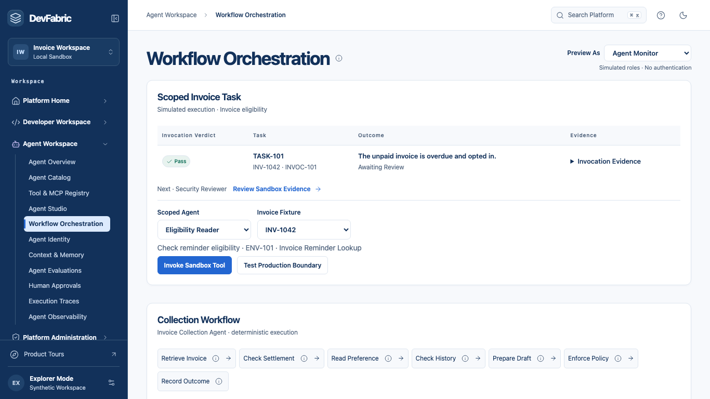

# DevFabric

**Unified Developer & Agent Platform**

Build Faster. Enable Agents. Govern Every Action.

## Product Vision

**From Business Intent to Trusted Software Delivery.** DevFabric connects the people, contracts and decisions behind a software change. A developer can trace a sandbox back to its approval. An agent operator can trace an invoice lookup back to its authority, expected result and reviewer.

## The Problem

Delivering an invoice reminder starts with finding an API owner, getting a compliant environment and agreeing on a contract. An agent needs more: a discoverable tool, permission to call it and evidence that it returned the right answer. When those decisions live in separate tools, the next person must reconstruct what happened.

## The Platform

| Strategic pillar | What a team can do in the preview |
| --- | --- |
| **Self-Service Infrastructure** | Onboard a service, inspect a plan and trace a policy-checked sandbox request from decision to environment. |
| **Agent-Ready Enterprise APIs** | Repair missing contract evidence, publish a reviewed revision and evaluate a scoped sandbox invocation. |

Both journeys use shared ownership, policy and evidence records. The context graph helps explain dependencies and tool fit.

## Explore DevFabric

Choose **Open Workspace** to create synthetic records in your browser. Choose **Guided Platform Tour** for an isolated practice session. [Open the product preview](https://feature-devfabric-platform-e.enablement-hub.pages.dev/) · [Explore the five business cases](https://feature-devfabric-platform-e.enablement-hub.pages.dev/cases)

## Product Vision Film

Play the captioned 82-second film under **Platform Vision**, immediately below the homepage hero. The closing sequence illustrates the longer-term vision. [Watch the film in DevFabric](https://feature-devfabric-platform-e.enablement-hub.pages.dev/home/overview)

## Developer Journey

A billing team registers its service, selects the Invoice API contract and requests sandbox access. An administrator reviews the request. A successful simulated provision produces an environment linked to the decision. A rejection leaves a reason and a path to retry. [Follow the developer journey](docs/developer-journey.md)

## Agent Journey

An API owner repairs two readiness gaps and publishes the reviewed revision. An operator registers a scoped agent and runs the lookup against a specific invoice. The receipt below shows a passing answer awaiting human review. A subsequent production probe is denied. [Follow the agent journey](docs/agent-journey.md)

## Enterprise Context Graph

From the gallery, catalog or tool registry, inspect a read-only view of service dependencies and agent tool context. Simulating a change to Payment Status API identifies potential consumers and proposed review owners. A tool recommendation separates business fit, invocation prerequisites and prior evidence. Each relationship has a provenance label. [Explore the graph](docs/context-graph.md)

## Product Capabilities

| Scope | Examples |
| --- | --- |
| Implemented local workflows | Onboarding, requests, readiness, publication, task evaluation, human review and operational metrics. |
| Simulated external operations | Cloud provisioning, build and staging, invoice lookup and reminder delivery. |
| Future-capability simulation | Interactive graph with recorded, derived and illustrative relationships. |
| Long-term vision | Verified enterprise context and governed orchestration across teams. |

## Product Strategy

Start with one complete invoicing workflow. Reuse its catalog, policy decisions and receipts across both personas. Evaluate whether teams can reach staging, explain a denial and recover a blocked run before expanding to other domains. [Strategic choices](docs/product-strategy.md)

## Architecture

The preview replays a browser-local command log across workspaces. Case rehearsals and practice tours keep separate state. The graph reads operational records without writing decisions or granting access. [Architecture and evidence flow](docs/architecture.md)

## Roadmap

The current foundation supports repeatable decisions in a synthetic sandbox. A controlled team pilot would introduce trusted identity, server-side policy and durable evidence. Multi-team expansion depends on isolation, repeat adoption and verified recovery. [Roadmap and decision criteria](docs/roadmap.md)

## Product Documentation

| Explore | Guides |
| --- | --- |
| Customers and product direction | [Vision](docs/vision.md) · [Problem and opportunity](docs/problem-and-opportunity.md) · [Personas and jobs](docs/personas-and-jtbd.md) |
| Platform priorities | [Product strategy](docs/product-strategy.md) · [Capability map](docs/capability-map.md) · [Roadmap](docs/roadmap.md) |
| Workflows | [Developer journey](docs/developer-journey.md) · [Agent journey](docs/agent-journey.md) |
| Decisions and outcomes | [Context graph](docs/context-graph.md) · [Architecture](docs/architecture.md) · [Governance](docs/governance.md) · [Metrics and outcomes](docs/metrics-and-outcomes.md) |
