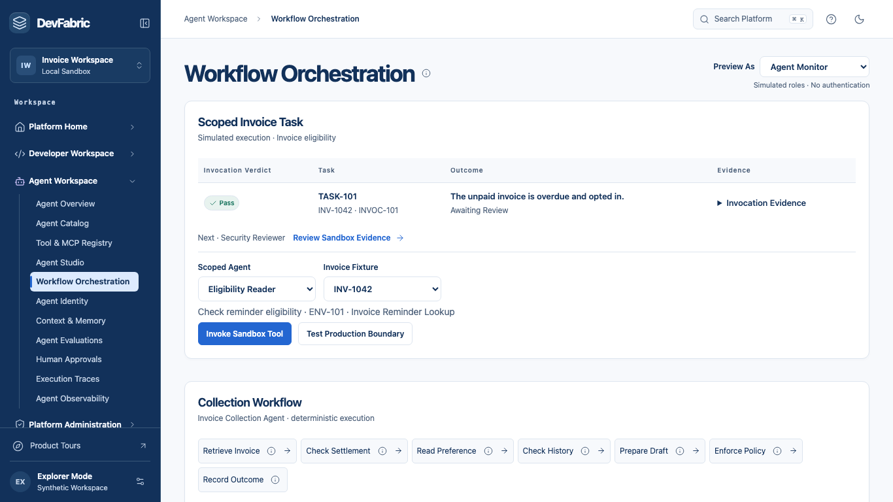

# Agent Journey

Check an invoice's reminder eligibility using a published tool and explain the resulting decision. Continue from a ready sandbox. **Preview As** selects the persona responsible for each local action.

| Stage and trigger | Who acts and what they do | Output and value |
| --- | --- | --- |
| A business task needs an API | The API owner registers the read-only invoice contract and assesses readiness. | The initial sample identifies two missing assets. The owner repairs the response and timeout evidence, then reassesses the new revision. |
| A revision is ready for review | The security reviewer approves that revision. The API owner publishes its tool. | Invoice Reminder Lookup becomes discoverable in Tool & MCP Registry. Editing the contract requires fresh evidence and authorization. |
| An operator needs a suitable tool | Inspect the tool, contract and required scope. Register the scoped sandbox agent with an owner and purpose. | The candidate fits the task. Invocation still requires the current grant, revision and permitted environment. |
| An invoice needs a decision | Run the lookup on a specific invoice. The evaluator derives the expected eligibility from the fixture and compares it with the actual tool response. | The receipt binds task, invocation, invoice, revision and evaluator version to Pass, Fail or Inconclusive. The contract's regression suite is separate. |
| Evidence requires a human decision | The reviewer inspects the receipt and approves or rejects it. | The same task moves out of pending review. The disposition is available to the operator and the product manager. |
| Someone asks to run in production | Test the production boundary after a successful sandbox task. | The workspace records the ENV-01 denial. The prior Pass and review do not grant production access. |

The separate collection workflow simulates drafting and recording a reminder in an outbox. A lookup receipt records an eligibility answer. It does not itself send a reminder. In the collection workflow, payment, consent, previous delivery and the current grant can all prevent dispatch.

[Explore the tool registry](https://feature-devfabric-platform-e.enablement-hub.pages.dev/agent/tool-mcp-registry)
