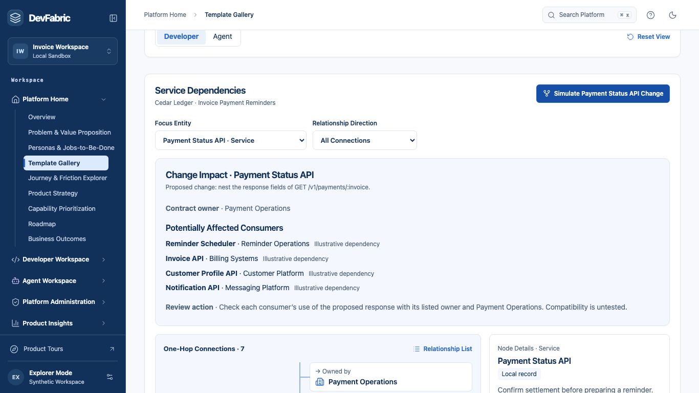

# Enterprise Context Graph

The Cedar Ledger invoice reminder scenario connects two questions. A developer can inspect who might need to review an API change. An agent builder can inspect which tool fits a task, what evidence exists, and which checks still belong to the runtime.

## Where to enter

- In **Template Gallery**, search for **Enterprise Context Graph**. Select **Solution Blueprints** and **Future Capability Simulation**, open the blueprint, then choose **Explore Developer Dependencies** or **Explore Agent Tool Context**.
- In **Service Catalog**, inspect a service and choose **Explore Dependencies**. Select **Downstream Connections** and inspect **Reminder Scheduler**. Its contract-change action is unavailable because the scheduler has no recorded contract. From Invoice API, select **Payment Status API**, choose **Explore From Here**, then **Simulate Payment Status API Change**. The response-shape change is hypothetical. The result identifies potentially affected consumers, their review contacts and a compatibility check.
- In **Tool & MCP Registry**, choose **Explore Tool Context** on a tool row. Choose **Check reminder eligibility** and simulate the recommendation. In a fresh workspace the lookup is proposed. **Why This Tool** explains the fit, **Before Invocation** shows the setup and current runtime checks, and **Prior Evidence** shows the matching receipt or its absence. Receipt history never substitutes for runtime checks. After using the existing operational workflow, the same view can show a published revision and a matching recorded verdict.

Both perspectives use the same one-hop map. The graph and list read the same directed edges. For **Depends on**, the arrow runs from the consumer to the provider. Invoice API uses Payment Status API in the illustrative fixture, so the former is downstream of the latter from either entry. API contracts are provided interfaces and are excluded from the list of impacted consumers. Upstream shows prerequisites and owners. Downstream shows consumers and the interfaces a service provides. Select a neighbor for its source and rationale, then choose **Explore From Here** to change the focus. **Relationship List** presents the same edges as complete statements.

Captured on the graph release preview at 1366 × 768.

## Reading the evidence

| Label | Meaning | Example |
| --- | --- | --- |
| Local record | A field or receipt in the current synthetic workspace. | Catalog owner or a sandbox receipt for the selected tool, agent and published revision. |
| Derived | A relationship obtained by joining local records or applying a known rule. | An environment linked to its request. |
| Illustrative | A scenario assumption that needs validation. | Reminder Scheduler consuming Payment Status API. |

The graph projects existing records into a one-hop view. Exploring a node preserves the operational command log. A contract-change result suggests who should review compatibility. A tool recommendation explains fit and prerequisites. Neither action changes policy, calls a service or authorizes a future invocation. Enterprise-wide discovery and live dependency validation belong to the longer-term vision.

[Open the graph blueprint](https://feature-devfabric-platform-e.enablement-hub.pages.dev/home/template-gallery?template=enterprise-context-graph)
